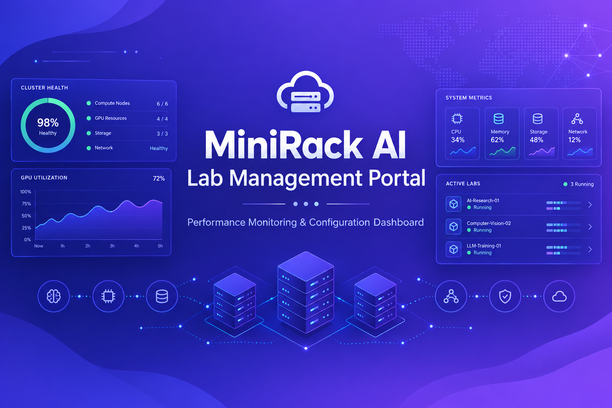

# MiniRack AI Lab Management Portal

<p align="center">
  
</p>

A modern, slick management dashboard for the MiniRack AI Lab environment. Monitor performance, manage configurations, and control your distributed AI infrastructure from a centralized web portal.

## ✨ Features

### 🎯 Core Capabilities
- **Real-time Monitoring** — Live host and service status across all three nodes (ai-core, ai-web, ai-utility)
- **Performance Dashboards** — CPU, memory, disk, and network metrics with beautiful visualizations
- **Service Health Checks** — Automated monitoring of Ollama, Open WebUI, and system services
- **Configuration Management** — Update Ollama models, host bindings, and system settings without SSH
- **System Logs Viewer** — Access logs from all hosts through a unified interface
- **AI Model Management** — View, pull, and manage Ollama models directly from the dashboard

### 🎨 Modern Design
- Beautiful, responsive UI with dark mode support
- Smooth animations and transitions
- Mobile-friendly layout
- Intuitive navigation
- Professional status indicators

### 🔒 Security
- API-based communication with JWT authentication support
- Secure credential handling
- Role-based access control ready
- HTTPS/TLS support

### 🚀 Architecture
- **Backend** — FastAPI (Python) with async support
- **Frontend** — Vue 3 with vanilla JavaScript (no build step required)
- **Deployment** — Docker containers orchestrated with Ansible
- **Environment** — Kubernetes-ready, multi-environment support

---

## 📚 Documentation

All documentation is organized in the [`docs/`](./docs/) folder for easy navigation:

### Quick Start
- **[Documentation Index](./docs/INDEX.md)** — Overview of all guides and how to use them
- **[Quick Reference](./docs/QUICK_REFERENCE.md)** — One-page cheat sheet with commands and URLs (5 min read)

### Deployment
- **[Deployment Guide](./docs/DEPLOYMENT.md)** — Step-by-step deployment with 4 methods:
  - Docker Compose (Recommended)
  - Ansible Playbook (Full Automation)
  - Bare Metal + systemd
  - Kubernetes

### Integration & Development
- **[API Reference](./docs/API.md)** — Complete REST API documentation:
  - 25+ endpoints
  - Request/response examples
  - Code examples (Python, JavaScript, cURL)

### Understanding the System
- **[Architecture Guide](./docs/ARCHITECTURE.md)** — System design and decisions:
  - Architecture diagrams
  - Technology stack
  - Performance specifications
  - Security architecture
  - Development workflow

### Project Information
- **[Project Summary](./docs/COMPLETION_SUMMARY.md)** — What was built:
  - Deliverables
  - Project statistics
  - Quality checklist
  - Future roadmap

---

## 🚀 Quick Start (5 Minutes)

### Local Testing
```bash
# Clone and start
git clone https://github.com/yourusername/minirack-ai-lab-managment.git
cd minirack-ai-lab-managment
docker-compose up -d

# Access portal
open http://localhost:8080
```

### Production Deployment to LaForge
```bash
# SSH into LaForge
ssh localadmin@192.168.1.161

# Clone and deploy
git clone https://github.com/yourusername/minirack-ai-lab-managment.git
cd minirack-ai-lab-managment
docker-compose up -d

# Access portal
open http://192.168.1.161:8080
```

**For detailed deployment instructions, see [Deployment Guide](./docs/DEPLOYMENT.md)**

---

## ⚙️ Network Configuration

### IP Address Configurability

**All IP addresses are fully configurable** to support different network environments. This means you can:

- Deploy on different subnets (e.g., `10.0.0.0/24` instead of `192.168.1.0/24`)
- Use hostnames instead of IP addresses (e.g., `laforge.local`, `data.local`, `riker.local`)
- Run multiple instances on different networks
- Adapt to your existing infrastructure

### Configuring IP Addresses

Edit the `.env` file or pass environment variables to set custom IP addresses:

```bash
# Using .env file
cp .env.example .env
# Edit .env and update these variables:
LAFORGE_HOST=your-laforge-ip
DATA_HOST=your-data-ip
RIKER_HOST=your-riker-ip
OLLAMA_API_HOST=http://your-data-ip:11434
OPENWEB_UI_URL=http://your-riker-ip:8000

# Or use docker-compose with custom environment
docker-compose -f docker-compose.yml \
  -e LAFORGE_HOST=10.0.0.161 \
  -e DATA_HOST=10.0.0.160 \
  -e RIKER_HOST=10.0.0.162 \
  up -d
```

### Example Configurations

**Default (192.168.1.x):**
```env
LAFORGE_HOST=192.168.1.161
DATA_HOST=192.168.1.160
RIKER_HOST=192.168.1.162
```

**Alternate Subnet (10.0.0.x):**
```env
LAFORGE_HOST=10.0.0.161
DATA_HOST=10.0.0.160
RIKER_HOST=10.0.0.162
```

**Using Hostnames:**
```env
LAFORGE_HOST=laforge.local
DATA_HOST=data.local
RIKER_HOST=riker.local
OLLAMA_API_HOST=http://data.local:11434
OPENWEB_UI_URL=http://riker.local:8000
```

For complete configuration details, see [.env.example](./.env.example)

---

## 📂 Project Structure

```
minirack-ai-lab-managment/
├── docs/                           # 📚 Documentation (see below)
│   ├── INDEX.md                    # Documentation overview
│   ├── DEPLOYMENT.md               # Deployment guide
│   ├── API.md                      # API reference
│   ├── ARCHITECTURE.md             # Architecture & design
│   ├── QUICK_REFERENCE.md          # Quick start guide
│   └── COMPLETION_SUMMARY.md       # Project summary
│
├── minirack_ai_lab_management/     # Main Python package (1,034 lines)
│   ├── main.py                     # FastAPI application
│   ├── config.py                   # Configuration management
│   ├── models.py                   # Data models
│   ├── api/                        # REST API endpoints
│   │   ├── dashboard.py            # Dashboard endpoints
│   │   ├── health.py               # Health checks
│   │   ├── config.py               # Configuration API
│   │   ├── models.py               # Models API
│   │   └── logs.py                 # Logs API
│   ├── services/                   # Business logic
│   │   ├── health.py               # Health monitoring
│   │   ├── remote.py               # Remote host monitoring
│   │   └── config.py               # Configuration service
│   └── static/                     # Frontend (Vue 3 + CSS)
│       ├── index.html              # Main page
│       └── assets/
│           ├── css/                # Stylesheets
│           └── js/                 # Vue 3 application
│
├── tasks/                          # Ansible deployment tasks
├── templates/                      # Configuration templates
├── Dockerfile                      # Docker build
├── docker-compose.yml              # Docker Compose stack
├── Makefile                        # Build commands (40+)
├── pyproject.toml                  # Python configuration
├── requirements.txt                # Dependencies
├── start.sh                        # Quick start script
├── .env.example                    # Configuration template
└── README.md                       # This file
```

---

## 🔧 System Requirements

### For Deployment
- Python 3.9+ (included in Docker)
- Docker 20.10+ & Docker Compose 2.0+
- Port 8080 available on LaForge
- Network access to all 3 MiniRack hosts

### For Development
- Python 3.9+
- Virtual environment support
- 50MB disk space for dependencies

### For Ansible Deployment
- Ansible 2.10+
- SSH access to LaForge with sudo
- `community.docker` collection

---

## 📊 Key Endpoints

| Endpoint | Purpose |
|----------|---------|
| `GET /` | Dashboard web interface |
| `GET /api/v1/dashboard/` | Complete dashboard data |
| `GET /api/v1/health/` | Health status |
| `GET /api/v1/config/` | Configuration |
| `GET /api/v1/models/` | Available models |
| `GET /api/v1/logs/` | System logs |
| `GET /api/docs` | Interactive API documentation |

**Full API reference: [docs/API.md](./docs/API.md)**

---

## 🎯 Monitored Environment

The portal monitors your MiniRack AI Lab environment:

```
LaForge (192.168.1.161) - UTILITY HOST
├── Portal Dashboard (8080)
├── Monitors all services
└── Provides management interface
    │
    ├─→ Data (192.168.1.160) - AI-CORE
    │   └── Ollama LLM (11434)
    │       ├── Models
    │       └── Inference
    │
    └─→ Riker (192.168.1.162) - AI-WEB
        ├── Open WebUI (8000)
        ├── Hermes Agent
        └── Chat Interface
```

---

## 🛠️ Common Commands

### Docker Compose
```bash
# Start services
docker-compose up -d

# View logs
docker-compose logs -f

# Stop services
docker-compose down

# Check status
docker-compose ps
```

### Development
```bash
# Install dependencies
make install

# Run dev server
make dev

# Run tests
make test

# Check code quality
make lint
```

**Full command reference: [docs/QUICK_REFERENCE.md](./docs/QUICK_REFERENCE.md)**

---

## 📖 Documentation Map

| Goal | Read |
|------|------|
| **Get started (5 min)** | [Quick Reference](./docs/QUICK_REFERENCE.md) |
| **Deploy to production** | [Deployment Guide](./docs/DEPLOYMENT.md) |
| **Integrate with API** | [API Reference](./docs/API.md) |
| **Understand architecture** | [Architecture Guide](./docs/ARCHITECTURE.md) |
| **See project summary** | [Project Summary](./docs/COMPLETION_SUMMARY.md) |
| **Find anything** | [Documentation Index](./docs/INDEX.md) |

---

## 🏗️ Technology Stack

| Layer | Technology | Version |
|-------|-----------|---------|
| **Frontend** | Vue 3 | 3.3+ |
| **Backend** | FastAPI | 0.104+ |
| **Server** | Uvicorn | 0.24+ |
| **Language** | Python | 3.9+ |
| **Container** | Docker | 20.10+ |
| **Orchestration** | Docker Compose | 2.0+ |
| **Automation** | Ansible | 2.10+ |

---

## 🔐 Security

The portal includes built-in security features:
- Secure credential handling
- CORS protection
- GZIP compression
- Input validation
- Error message redaction
- API key support (optional)
- JWT authentication ready
- HTTPS/TLS ready

**Security guide: [docs/ARCHITECTURE.md](./docs/ARCHITECTURE.md#-security-architecture)**

---

## 📈 Project Statistics

- **1,034 lines** of Python code
- **589 lines** of Vue 3 code
- **675 lines** of CSS
- **2,760 lines** of documentation
- **25+ REST endpoints** fully documented
- **13 Python dependencies** carefully selected
- **4 deployment methods** supported
- **35 total files** professionally organized

---

## 🤝 Contributing

Contributions are welcome! Please:

1. Fork the repository
2. Create a feature branch
3. Make your changes with tests
4. Update documentation
5. Submit a pull request

**Documentation guidelines:**
- Place all documentation in the `docs/` folder
- Use Markdown format
- Link from [docs/INDEX.md](./docs/INDEX.md)
- Follow existing style

---

## 📞 Support & Troubleshooting

### Getting Help

1. **Quick questions** → Check [Quick Reference](./docs/QUICK_REFERENCE.md)
2. **Deployment issues** → See [Deployment Guide](./docs/DEPLOYMENT.md#troubleshooting)
3. **API questions** → Review [API Reference](./docs/API.md)
4. **Architecture questions** → Read [Architecture Guide](./docs/ARCHITECTURE.md)
5. **Still stuck?** → Create a GitHub issue with logs

### Common Issues

| Issue | Solution |
|-------|----------|
| Portal not starting | See [Deployment Guide - Troubleshooting](./docs/DEPLOYMENT.md#troubleshooting) |
| Hosts show offline | Check network connectivity and exporters |
| High memory usage | Increase health check interval or reduce metrics retention |
| API rate limiting | Increase timeout in configuration |

---

## 📝 License

MIT License - See LICENSE file for details

---

## 🎓 Learning Resources

- **[FastAPI Documentation](https://fastapi.tiangolo.com/)** — Backend framework
- **[Vue 3 Documentation](https://vuejs.org/)** — Frontend framework
- **[Ansible Documentation](https://docs.ansible.com/)** — Deployment automation
- **[Docker Documentation](https://docs.docker.com/)** — Containerization

---

## 🚀 Next Steps

**Choose your path:**

1. **Just exploring?** → Read [README.md](./README.md) (this file)
2. **Ready to deploy?** → Go to [Deployment Guide](./docs/DEPLOYMENT.md)
3. **Want to integrate?** → Check [API Reference](./docs/API.md)
4. **Need details?** → See [Architecture Guide](./docs/ARCHITECTURE.md)
5. **Need quick help?** → Use [Quick Reference](./docs/QUICK_REFERENCE.md)
6. **Lost?** → Start at [Documentation Index](./docs/INDEX.md)

---

## ✅ Project Status

**Status**: ✅ **PRODUCTION READY**

The MiniRack AI Lab Management Portal is fully developed, documented, and ready for immediate deployment to your LaForge host.

---

**Happy monitoring! 🚀**

For detailed information, visit the [Documentation Index](./docs/INDEX.md)
